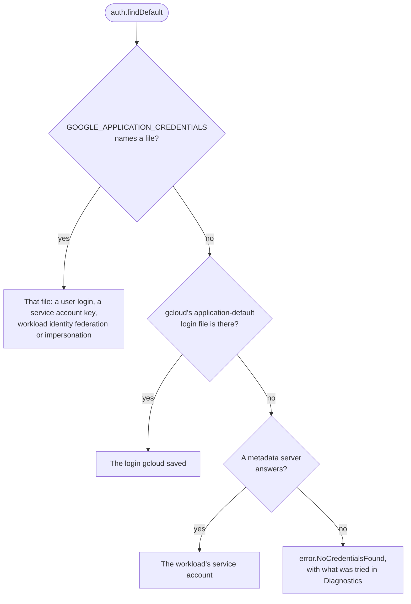

[Docs](README.md) › Credentials

# 🪪 Credentials

Production needs a `TokenProvider`, and the `auth` module makes one.
`auth.findDefault` picks it the way Google's own libraries do, so the
same binary runs on a laptop and on Cloud Run without a flag:

```zig
var arena: std.heap.ArenaAllocator = .init(gpa);
defer arena.deinit();
const lookup = try auth.Lookup.fromEnv(init.environ_map, arena.allocator());
var creds = try auth.findDefault(gpa, io, lookup, .{});
defer creds.deinit();
std.log.info("credentials from {t}", .{creds.source});

var client = try pubsub.Client.init(gpa, io, .{
    .project_id = "my-project",
    .token_provider = creds.provider(),
});
```

Every service module takes the same provider: `storage.Client` and
`secret_manager.Client` are made the same way.

`creds.provider()` also carries the project to charge for quota, which
user credentials name: the client sends it as `x-goog-user-project`, and
`send_quota_project` turns that off. When a call comes back 401, the
client drops the cached token, fetches another and tries once more.
`creds.projectId(io, arena)` says which project the program runs in,
when the credentials know: the metadata server does, and a service
account key file names the project it belongs to; a user login does not.
On Google Cloud that means a program needs no configuration at all.

**On this page:** [Where `findDefault` looks](#where-finddefault-looks) ·
[Which account](#which-account) ·
[Choosing a source yourself](#choosing-a-source-yourself) ·
[Service account keys](#service-account-keys) ·
[Workload identity federation](#workload-identity-federation) ·
[Acting as a service account](#acting-as-a-service-account) ·
[A static token](#a-static-token) · [Signing](#signing)

## Where `findDefault` looks



It looks in three places, in this order:

1. The credentials file `GOOGLE_APPLICATION_CREDENTIALS` names: a user
   login (`authorized_user`), a service account key (`service_account`),
   workload identity federation (`external_account`), or a login that
   acts as a service account (`impersonated_service_account`).
2. The file `gcloud auth application-default login` writes, under
   `$HOME/.config/gcloud` or `%APPDATA%\gcloud`.
3. The metadata server, on Cloud Run, GKE, GCE or Cloud Functions, which
   hands out tokens for the workload's service account with nothing
   stored on disk.

The first place that has something decides it. A credential that is
there but unusable is an error, never a reason to try the next place:
running as somebody else, quietly, would be worse. With nothing
anywhere, the error is `NoCredentialsFound` and `Diagnostics` lists what
was tried.

## Which account

`creds.account(io, arena)` names the account the credentials act as: for
a status bar that says who is signed in, or for state an app keeps per
identity. It answers null when the credentials cannot say, and
`Diagnostics` then says why.

<!-- snippet: tests/docs_examples.zig#auth-account -->
```zig
/// Who the app is signed in as, for its status bar. When the credentials
/// cannot name an account, Diagnostics say why.
fn signedInAs(creds: auth.Credentials, io: std.Io, arena: std.mem.Allocator) ![]const u8 {
    return try creds.account(io, arena) orelse "an account the credentials cannot name";
}
```

| Credentials | The account |
| --- | --- |
| A service account key | its `client_email` |
| A login that acts as a service account, or workload identity federation that impersonates one | the account as its URL names it: an email, or a numeric unique id as written |
| The metadata server | the attached service account; on GKE under Workload Identity with no service account bound, the pool, `PROJECT.svc.id.goog` |
| A person's own login | the email Google's token endpoint names with each token |
| Workload identity federation without impersonation | null: Google gives no way to name a federated principal |

A person's login names its account in the `id_token` that Google's token
endpoint sends with each access token, when the login granted `openid`
and `userinfo.email`. `gcloud auth application-default login` grants both
by default. The library reads that token as OpenID Connect allows for one
received straight from the token endpoint over TLS. It does not check the
signature, but the issuer must be Google's, the audience must be this
login's client, and the email must be verified. Failing that, the
credentials file's `account` answers, which gcloud fills in only for
`gcloud auth application-default login ACCOUNT`.

The first call fetches a token if none was fetched yet; after that it
answers without a request, and it never refreshes a token just to name
the account. The email is never logged. Google warns that a person's
email can change over time; a service account's cannot.

## Choosing a source yourself

To choose a source yourself, use `auth.AuthorizedUser.initFromFile` for
a user login, `auth.ServiceAccount.initFromFile` for a key file,
`auth.ExternalAccount.initFromFile` for federation,
`auth.ImpersonatedServiceAccount.initFromFile` for impersonation, or
`auth.MetadataServer` on Google Cloud, whose `probe` answers whether
there is a metadata server to ask (in half a second on a machine that
has none) and whose `projectId` says which project it runs in. None of
them may move while a client uses its provider; the `Credentials` that
`findDefault` returns may, because it keeps the provider on the heap.

## The metadata server's other keys

On Compute Engine the metadata server holds more than the account: the
VM's zone, the attributes whoever made it set, and whether a spot VM is
being taken back. `auth.MetadataServer` reads any of them with the
checks its token requests have: `Metadata-Flavor: Google` both ways, an
answer of 512 KiB at most, 10 s a request, and retries on 429 and 5xx.

- `get(io, arena, "instance/zone")` reads one key as text, as it was
  set (an attribute's trailing newline included). A path ending in `/`
  reads a directory's names, one a line.
- `instanceAttribute(io, arena, "job")` reads `instance/attributes/job`,
  or null when it is not set.
- `preempted(io)` says whether Compute Engine has begun to preempt this
  spot VM.
- `watch(io, arena, path, .{ .last_etag = etag, .timeout_s = 300 })`
  waits for a key to change. The metadata server holds the request until
  the value's ETag is not `last_etag` or `timeout_s` (1 to 3600) runs
  out, and the answer carries the ETag to pass next time. With no
  `last_etag` it answers at once. Cancel the task to end a watch early.

A key that is not set is `error.NotFound`. The metadata server answers
that itself, so it does not mean this is not Google Cloud. A path with a
query, a `..` or a doubled slash is refused before it is sent
(`error.InvalidRequest`), as is a watch on a directory, which the server
refuses.

<!-- snippet: tests/docs_examples.zig#auth-preempted -->
```zig
/// A spot VM's worker runs until Compute Engine takes the VM back. The
/// metadata server holds each request until `instance/preempted` changes
/// or five minutes pass, so the worker wakes within moments of `TRUE`.
fn untilPreempted(metadata: *auth.MetadataServer, io: std.Io, arena: std.mem.Allocator) !void {
    var etag: ?[]const u8 = null;
    while (true) {
        const seen = try metadata.watch(io, arena, "instance/preempted", .{ .last_etag = etag, .timeout_s = 300 });
        if (std.mem.eql(u8, seen.value, "TRUE")) return;
        etag = seen.etag;
    }
}
```

When measured on 2026-11-05, a spot VM's `instance/preempted` turned
`TRUE` between 5 and 56 s after Compute Engine was asked to preempt it,
in three runs, and a watch woke 240 ms before a poll every half second
saw it.
`instance/maintenance-event` stayed `NONE` throughout, so it is not the
key to watch on a spot VM. `examples/spot_worker.zig` is such a worker,
and `--fake` runs it with no VM.

### Testing with the in-memory metadata server

`auth.testing.FakeMetadataServer` goes behind `Options.transport` and
answers as Compute Engine's metadata server did when measured on
2026-11-05. It starts with the project, the zone, the attached account's
email and token, `instance/preempted` as `FALSE` and
`instance/maintenance-event` as `NONE`, so `provider()` and `projectId`
work against it too. `set` puts in any other key, or replaces one, and
wakes a watch on it; `remove` takes one out; `preempt` sets
`instance/preempted` to `TRUE`, as Compute Engine does when it takes a
spot VM back. `refuseNext(n, status)` answers the next requests busy,
and `callCount` shows that a watch held one request instead of polling.
Its waits block on the `io` it is given, so give it one that can
(`std.testing.io` does).

<!-- snippet: tests/docs_examples.zig#auth-metadata-fake -->
```zig
test "a worker stops when its spot VM is preempted, with no VM" {
    const io = std.testing.io;
    var fake: auth.testing.FakeMetadataServer = .init(std.testing.allocator, io, .{});
    defer fake.deinit();
    // What the worker's controller set when it made the VM.
    try fake.set("instance/attributes/job", "resize-images");
    var metadata = try auth.MetadataServer.init(std.testing.allocator, io, .{ .transport = fake.transport() });
    defer metadata.deinit();
    var arena: std.heap.ArenaAllocator = .init(std.testing.allocator);
    defer arena.deinit();
    try std.testing.expectEqualStrings("resize-images", (try metadata.instanceAttribute(io, arena.allocator(), "job")).?);

    // Compute Engine takes the VM back while the worker watches.
    var worker = try io.concurrent(untilPreempted, .{ &metadata, io, arena.allocator() });
    try fake.preempt();
    try worker.await(io);
    try std.testing.expect(try metadata.preempted(io));
}
```

It answers as production does where a test could tell: a key not set,
or no such path, is 404 with the flavor header; a request without
`Metadata-Flavor: Google` (its value's case counts) is 403; a directory
without its trailing `/` is a 301 to it; a watch answers at once for
`last_etag=0` or an ETag that is not the current one, and waits for good
on a `timeout_sec` that is not a whole number. `?recursive=true` is not
modelled, and answers 501.

## Service account keys

A `ServiceAccount` signs a short-lived JWT with the key file's RSA key
(RS256, via `std.crypto`, checked against the key's own public half
before anything is sent) and trades it at the token endpoint. Its tokens
are minted for particular scopes, so the first `getToken` fixes them;
use a second provider for a second scope set.
`creds.bindsScopes()` says whether what `findDefault` found does this
(impersonation and federation do too; a person's login and the metadata
server hand out the same token whatever is asked), so a program that
gives each client its narrowest scope calls `find` once, and again per
scope set only when it answers true.

## Workload identity federation

An `ExternalAccount` is workload identity federation: no stored Google
key at all. Each fetch reads the third-party subject token from the
file's credential source (a file, as GitHub Actions and Kubernetes
write, or a URL, as Azure's metadata service answers), trades it at
Google's STS, and, when the file names a service account to impersonate,
trades once more at the IAM Credentials API. Subject tokens rotate, so
each fetch reads anew. AWS credential sources (which need request
signing) and executable sources (which run a subprocess) are refused by
name. Scopes fix on first use, as for a service account.

## Acting as a service account

An `ImpersonatedServiceAccount` is a login that acts as a service
account, which Google recommends over key files for running locally as
one: nothing of the service account is stored, only the right to act as
it. It is the file this writes, which `findDefault` then picks up like
any other:

```sh
gcloud auth application-default login --impersonate-service-account=SA_EMAIL
```

Each fetch takes a token from the file's source credentials (a user
login, or a service account key) and trades it at the IAM Credentials
API for one that is the service account's. The source keeps its own
cached token, so most fetches cost one request. Only the account's email
is read from the file's URL: the request always goes to Google's
endpoint, as Google's own libraries do, so a crafted file cannot send
your token anywhere else. The login needs
`roles/iam.serviceAccountTokenCreator` on the service account, and a
refusal says so. Scopes fix on first use, as for a service account.

## A static token

A static token also works, for about an hour:

```zig
var token: pubsub.StaticToken = .{ .token = access_token }; // gcloud auth print-access-token
```

Emulator endpoints never receive a token, even when a provider is set,
and any other endpoint must use `https`.

## Signing

`creds.signer()` signs Cloud Storage's signed URLs and POST policies: on
this machine with a service account key, or through IAM for a login that
impersonates a service account and for a workload on Google Cloud. A
user's own login and workload identity federation cannot sign, and
`signer()` is null; `auth.IamSigner` names an account to sign as through
IAM instead. [Who can sign](storage/signed-urls.md#who-can-sign) has the
whole table, and what each needs.
