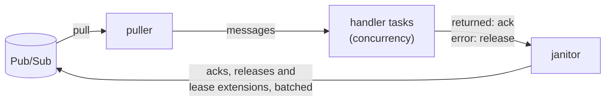

[Docs](../README.md) › [Pub/Sub](README.md) › Subscribing

# Subscribing

**On this page:** [A worker loop](#a-worker-loop) ·
[Exactly-once delivery](#exactly-once-delivery) ·
[Knowing whether an ack held](#knowing-whether-an-ack-held)

## A worker loop

Consuming a subscription for real means more than `pull` and `ack`:
leases must be extended while a handler runs, failures released for
redelivery, work bounded, and shutdown clean. `Subscriber` is that loop:

```zig
const Printer = struct {
    fn handler(self: *Printer) pubsub.Subscriber.Handler {
        return .{ .ptr = self, .vtable = &.{ .handle = handle } };
    }
    fn handle(ptr: *anyopaque, io: std.Io, message: pubsub.ReceivedMessage) anyerror!void {
        std.debug.print("{s}\n", .{message.data}); // return acks; an error releases
        _ = .{ ptr, io };
    }
};

var subscriber = try pubsub.Subscriber.init(gpa, io, .{
    .subscription_id = "orders-worker",
    .client = .{ .project_id = "my-project", .token_provider = creds.provider() },
    .concurrency = 4,
});
defer subscriber.deinit();
try subscriber.run(printer.handler()); // until subscriber.stop(), or a fatal error
```



`run` blocks and runs everything else on tasks of its own: one puller,
one janitor that batches acknowledgements, releases and lease
extensions, and `concurrency` handler tasks. A handler returning
acknowledges its message; an error releases it for redelivery, so
delivery is at least once and a handler must tolerate a duplicate.
Leases are extended for as long as a handler runs, up to
`max_extension_s`, after which the handler is presumed dead and the
server redelivers elsewhere. `max_outstanding` bounds how many
unresolved messages are held at once, and pulling pauses at the cap.

Transient failures anywhere are retried forever, further and further
apart; an error retrying cannot fix, such as the subscription being
deleted, stops the loop and comes back from `run` with the diagnostics
filled. A refusal that concerns single messages never stops it: an
acknowledgement the server refuses is counted, and its message may come
again, which at-least-once delivery allows. `stop` is safe to call from
a handler or another task: pulling stops, running handlers finish and
their messages resolve, buffered ones are released unhandled, and the
last acknowledgements are flushed. Acknowledgements go out within 100 ms
of a handler returning, batched.

`stats()` is a consistent snapshot of the counters at any time. `acked`
counts acknowledgements the server took, and `ack_failed` the ones it
refused or that were given up; once `run` has returned after `stop`,
every message received is counted exactly once among `acked`,
`ack_failed`, `nacked` and `receipt_refused`.

> [!NOTE]
> `run` reads the subscription first, for its ack deadline, which needs
> `pubsub.subscriptions.get`. `roles/pubsub.subscriber` does not grant
> it: with only that role, the read is refused, and `run` logs a warning
> and extends leases by 60 s instead. Setting `extension_period_s` skips
> the read.

[`examples/worker.zig`](../../examples/worker.zig) runs a `Subscriber`:
`zig build example-worker -- orders orders-worker`.

## Exactly-once delivery

A subscription created with `.enable_exactly_once_delivery = true` never
delivers again a message acknowledged within its lease, and refuses,
rather than takes, an acknowledgement or lease extension that comes
after the lease lapsed.

> [!TIP]
> Leave `ack_deadline_seconds` at 0 for such a subscription: Pub/Sub
> then gives it 60 s.

`Subscriber` handles it as Google's own clients do. It extends leases by
at least 60 s. It extends each pulled message's lease once before a
handler sees it, and drops, unhandled, any message whose lease the
server refuses there (`stats().receipt_refused`): its ack could never be
taken, and the server delivers it again. An ack refused for good is
counted in `ack_failed`; one refused only for now is sent again, backing
off from 1 s to 64 s, for up to 10 minutes. It learns that a
subscription has exactly-once delivery from reading it, or, when it may
not, from the first refusal that says so.

With `pull`, `ackWithResults` says what became of each id:

```zig
var results: [2]pubsub.AckResult = undefined;
try worker.ackWithResults(&.{ late.ack_id, fresh.ack_id }, &results);
// results: .{ .invalid_ack_id, .ok }: the late one was refused, the other taken.
```

An `AckResult` is `.ok`, `.invalid_ack_id` (refused for good: the lease
had lapsed, or the message was already acknowledged), `.transient`
(still refused for now after the client's retries) or `.other`.
Measured in production: when a request carries a lapsed id and a live
one, the server refuses the request, names only the lapsed id, and takes
the live one. `ack` fails with `error.InvalidArgument` when any id was
refused, after sending every id, and `Diagnostics` counts them.

Google's guarantee holds only when subscribers connect to the service in
the same region, and it asks for streaming pull, which this client does
not have, where throughput must be high.

## Knowing whether an ack held

A handler that returns has its message acknowledged about 100 ms later,
and never hears what came of it. One that must know, before work it must
not repeat, runs under `runDeliveries` instead of `run`. It is handed a
`Delivery`, whose `ack` waits for the server's answer:

<!-- snippet: tests/docs_examples.zig#pubsub-ack-outcome -->
```zig
/// Ships each order once. What can be done twice comes before the ack;
/// what must happen once waits for the ack to be taken.
const Shipping = struct {
    gpa: std.mem.Allocator,
    mutex: std.Io.Mutex = .init,
    /// By message id. A real one is a database.
    orders: std.StringHashMapUnmanaged(enum { reserved, shipped }) = .empty,

    fn handler(self: *Shipping) pubsub.Subscriber.DeliveryHandler {
        return .{ .ptr = self, .vtable = &.{ .handle = handle } };
    }

    fn handle(ptr: *anyopaque, io: std.Io, delivery: *pubsub.Subscriber.Delivery) anyerror!void {
        const self: *Shipping = @ptrCast(@alignCast(ptr));
        const id = delivery.message.message_id;
        try self.reserve(io, id); // harmless when the message comes again
        switch (try delivery.ack(io)) {
            // With exactly-once delivery, it will not come again.
            .taken => self.ship(io, id),
            // It may come again, and will find its reservation.
            .refused, .unknown => {},
        }
    }

    fn reserve(self: *Shipping, io: std.Io, id: []const u8) !void {
        self.mutex.lockUncancelable(io);
        defer self.mutex.unlock(io);
        if (self.orders.contains(id)) return;
        const owned = try self.gpa.dupe(u8, id);
        errdefer self.gpa.free(owned);
        try self.orders.put(self.gpa, owned, .reserved);
    }

    fn ship(self: *Shipping, io: std.Io, id: []const u8) void {
        self.mutex.lockUncancelable(io);
        defer self.mutex.unlock(io);
        self.orders.getPtr(id).?.* = .shipped;
    }
};
```

`ack` returns a `pubsub.AckOutcome`:

| Outcome | The server | The message |
| --- | --- | --- |
| `.taken` | took the acknowledgement | with exactly-once delivery, does not come again |
| `.refused` | refused it for good: the lease had lapsed, or the server had refused to extend it | may come again |
| `.unknown` | said neither: refusals for now outlasted 10 minutes of retries, the request was refused naming no message, or the subscriber stopped or failed first | may come again |

The ack goes out in the ordinary batch, so the wait is about 100 ms and a
round trip, and with exactly-once delivery up to 10 minutes while the
server refuses it for now. Meanwhile the message's lease is still
extended, up to `max_extension_s`, so a later try can be taken; plain
handlers' acks keep their leases the same way. `nack` releases the
message and waits for the answer as `ack` does. A second `ack` or `nack`
sends nothing and returns the first one's outcome. A handler that
settles nothing acks by returning and releases with an error, as a plain
one does. When `stop` comes, an ack refused for now gets one more try at
once, and is `.unknown` if refused again: `stop` never waits out the
10 minutes.

**Which comes first, the work or the ack.** Work done after the ack is
lost if the process dies in between; work done before it is repeated if
the ack fails. Google's advice for exactly-once delivery, which the
example follows, is to keep a record of each message's progress until
its ack holds: what can be done twice is done before the ack, and what
must happen once after `.taken`.

**Without exactly-once delivery**, `.taken` promises nothing about
redelivery: Pub/Sub may deliver any message again. The outcome is still
the server's answer. Google's own clients answer success at once there,
before the ack is even sent; this one waits, because it may not know yet
that a subscription has exactly-once delivery, which it learns from
reading the subscription or from a first refusal.
